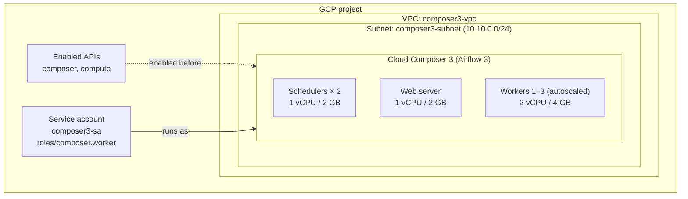

# Cloud Composer 3 on GCP with Terraform

A small, readable Terraform configuration that deploys **Google Cloud Composer 3** (managed **Apache Airflow 3**) with sensible defaults: the required APIs, a dedicated VPC and subnet, a purpose-built service account, and an explicitly sized Composer environment.

It is deliberately minimal: a baseline you can read in ten minutes, deploy as-is, and extend.

---

## What it creates

| Resource | Name (defaults) | Purpose |
|---|---|---|
| `google_project_service` × 2 | `composer.googleapis.com`, `compute.googleapis.com` | Enables the APIs Composer needs |
| `google_compute_network` | `composer3-vpc` | Dedicated VPC (custom subnets only), so Composer doesn't use the default network |
| `google_compute_subnetwork` | `composer3-subnet` (`10.10.0.0/24`) | Subnet for Composer workloads, with Private Google Access on |
| `google_service_account` | `composer3-sa` | Identity the Composer workloads run as |
| `google_project_iam_member` | `roles/composer.worker` | The single role Composer 3 needs to run |
| `google_composer_environment` | `var.environment_name` | Composer 3 environment on `composer-3-airflow-3` |



---

## Prerequisites

- Terraform **>= 1.5**
- A GCP project with billing enabled
- A GCS bucket for Terraform state
- Your account (or CI identity) needs at least:
  - `roles/composer.admin`
  - `roles/compute.networkAdmin`
  - `roles/iam.serviceAccountAdmin`
  - `roles/resourcemanager.projectIamAdmin` (to grant the worker role)
  - `roles/serviceusage.serviceUsageAdmin` (to enable APIs)
- Authenticated locally: `gcloud auth application-default login`

---

## Usage

This repo is a **root configuration**: you deploy it directly. Each environment has a backend file (where state lives) and a tfvars file (what to deploy).

```
envs/
├── sandbox.gcs.tfbackend        # state bucket + prefix for sandbox
├── sandbox.tfvars               # sandbox settings
├── prod.gcs.tfbackend.example   # copy → prod.gcs.tfbackend
└── prod.tfvars.example          # copy → prod.tfvars
```

### Deploy

```bash
# 1. Initialise against the environment's state
terraform init -backend-config=envs/sandbox.gcs.tfbackend

# 2. Review the plan
terraform plan -var-file=envs/sandbox.tfvars

# 3. Apply (Composer takes roughly 20–30 minutes to provision)
terraform apply -var-file=envs/sandbox.tfvars

# 4. Get the Airflow URL and DAG bucket
terraform output
```

### Add another environment

```bash
cp envs/prod.tfvars.example envs/prod.tfvars
cp envs/prod.gcs.tfbackend.example envs/prod.gcs.tfbackend
# edit both files, then:
terraform init -reconfigure -backend-config=envs/prod.gcs.tfbackend
terraform plan -var-file=envs/prod.tfvars
```

To run two environments **in the same project**, give each a different `resource_prefix` so the VPC, subnet and service account names don't collide.

### Deploy DAGs

```bash
gsutil cp my_dag.py "$(terraform output -raw dag_gcs_prefix)/"
```

---

## Design choices

- **Dedicated network.** Composer gets its own VPC and subnet rather than the project's default network, giving clear boundaries for firewall rules, peering, and connectivity to source systems. Set `enable_private_environment = true` to run without public IPs on the workloads.
- **Least-privilege identity.** Composer runs as its own service account with only `roles/composer.worker`, not the default Compute Engine account. Grant data-access roles (BigQuery, GCS, Secret Manager) separately, scoped to what your DAGs use.
- **Explicit sizing.** Scheduler, web server and worker resources are stated in code, so changes are reviewed like any other change.

  | Component | CPU | Memory | Storage | Count |
  |---|---|---|---|---|
  | Scheduler | 1 | 2 GB | 5 GB | 2 |
  | Web server | 1 | 2 GB | 5 GB | 1 |
  | Worker | 2 | 4 GB | 10 GB | `worker_min_count`–`worker_max_count` (default 1–3) |

- **Pinned dependencies.** PyPI packages are pinned through `pypi_packages` (defaults: `pymssql==2.3.2`, `pandas==2.2.3`), so a package release can't silently break DAGs.
- **Explicit ordering.** The environment `depends_on` the APIs and the IAM grant, so a first apply on a new project doesn't race API enablement.
- **APIs stay enabled on destroy** (`disable_on_destroy = false`), so tearing down Composer doesn't break other workloads in the project.

---

## Inputs

| Name | Description | Type | Default | Required |
|---|---|---|---|:---:|
| `project_id` | GCP project ID to deploy into | `string` | n/a | **yes** |
| `region` | Region for Composer and its subnet | `string` | `"europe-west2"` | no |
| `environment_name` | Composer environment name; also exposed to DAGs as `ENVIRONMENT` | `string` | `"dev"` | no |
| `resource_prefix` | Prefix for VPC, subnet and service account names | `string` | `"composer3"` | no |
| `subnet_cidr` | Primary IP range of the subnet | `string` | `"10.10.0.0/24"` | no |
| `enable_private_environment` | Run Composer 3 without public IPs on workloads | `bool` | `false` | no |
| `pypi_packages` | PyPI packages, name ⇒ version specifier | `map(string)` | `pymssql`, `pandas` pinned | no |
| `worker_min_count` | Minimum Airflow workers | `number` | `1` | no |
| `worker_max_count` | Maximum Airflow workers | `number` | `3` | no |
| `labels` | Extra labels for the environment | `map(string)` | `{}` | no |

## Outputs

| Name | Description |
|---|---|
| `environment_name` | Name of the Composer environment |
| `airflow_uri` | URL of the Airflow web UI |
| `dag_gcs_prefix` | GCS path to upload DAGs to |
| `service_account_email` | Service account Composer runs as |
| `network_id` | ID of the dedicated VPC |
| `subnetwork_id` | ID of the Composer subnet |

---

## Files

```
.
├── main.tf               # Composer 3 environment
├── networking.tf         # VPC and subnet
├── service_accounts.tf   # Service account and IAM role
├── apis.tf               # API enablement
├── providers.tf          # google / google-beta provider config
├── backend.tf            # GCS backend (configured per environment)
├── variables.tf          # Inputs
├── outputs.tf            # Outputs
├── envs/                 # Per-environment backend and tfvars files
├── .tflint.hcl           # Lint rules
└── .github/workflows/    # CI: fmt, validate, tflint on every PR
```

---

## Troubleshooting

**Environment stays in `CREATING` for a long time.** Normal: allow up to 30 minutes. If it goes beyond that, check **Composer → Environments** in the Cloud Console for the error.

**Permission denied creating the service account or IAM binding.** Check your account has the roles listed under Prerequisites.

**`environment_name` changed and the plan wants to replace the environment.** Composer environment names can't be changed in place; renaming means a full rebuild.

---

## License

See [LICENSE](LICENSE).
